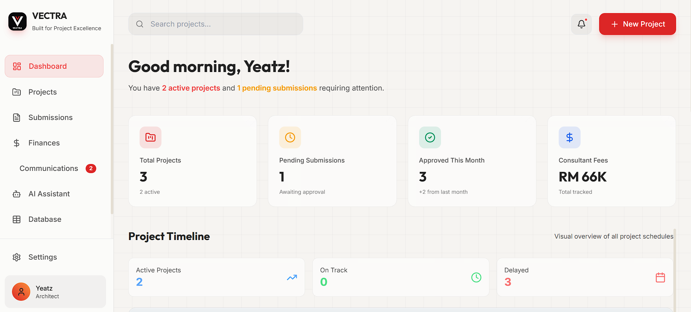
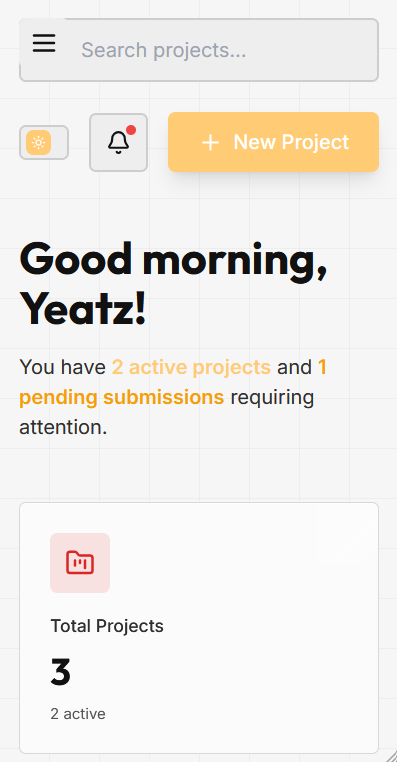

# VECTRA

> Built for Project Excellence

VECTRA is a professional project management and project tracking platform designed for architecture, engineering, and construction (AEC) firms. It centralizes project data, regulatory submissions, client communications, financial tracking, site documentation, and invoicing within a single streamlined workspace.

---

## 🖥️ Preview

### Desktop View


### Mobile View


---

## ✨ Key Features

### 📁 Project Management
- Create and manage projects with client information, budgets, timelines, and project notes.
- Track project status from initiation to completion.

### 🏛 Regulatory Submission Tracking
- Monitor planning approvals, permits, and regulatory submissions.
- Track submission fees, dates, and approval statuses.

### 📊 Project Timeline & Progress Monitoring
- Interactive Gantt-style project timeline.
- Visual progress indicators and milestone tracking.

### 📷 Site Documentation
- Upload and manage site photos.
- Organize project records in a centralized repository.

### 💰 Invoicing & Financial Management
- Generate professional invoices.
- Export invoices to PDF or print format.
- Email invoices directly to clients.
- Track consultant fees and project budgets.

### 🤖 AI Communication Manager
- Intelligent client communication tools.
- Automated responses and communication tracking.

### 🔔 Smart Notifications
- Real-time project notifications.
- Read-status awareness to keep teams informed.

### 👤 Profile & Company Management
- Manage company and user profiles.
- Upload branding assets and profile photos.

### 🗄 Database Management
- Organize clients, tasks, documents, and project notes.
- Centralized data management across projects.

---

## 🛠 Technology Stack

| Layer | Technology |
|---------|------------|
| Frontend | React 19, TypeScript |
| Styling | Tailwind CSS |
| Build Tool | Vite |
| Desktop App | Electron |
| Backend | Cloudflare Workers (Hono) |
| Database | D1 Ready / Local Storage (Demo) |
| Icons | Lucide React |

---

## 🚀 Getting Started

### Prerequisites

- Node.js 18+
- npm

### Installation

```bash
npm install
```

### Run Web Application

```bash
npm run dev
```

Visit:

```text
http://localhost:5173
```

### Run Desktop Application

```bash
npm run electron:dev
```

### Build for Production

```bash
npm run build
```

### Build Desktop Application

```bash
npm run electron:build
```

---

## 🌐 Live Demo

🔗 https://vectra-project-tracker.vercel.app/

---

## 📦 Deployment

VECTRA is deployed using **Vercel**.

Every commit pushed to the `main` branch automatically triggers a new deployment.

---

## 📂 Project Structure

```text
src/
├── react-app/
│   ├── components/
│   ├── services/
│   └── data/
│
├── worker/
│   └── Cloudflare Worker (Hono)
│
public/
├── screenshot-desktop.png
├── screenshot-mobile.png
└── assets
```

---

## 🎯 Target Industry

- Architecture Firms
- Engineering Consultants
- Construction Management Teams
- Design & Build Companies
- Project Management Consultants

---

## 📄 License

© VECTRA. All Rights Reserved.

This repository is provided for demonstration and development purposes.
